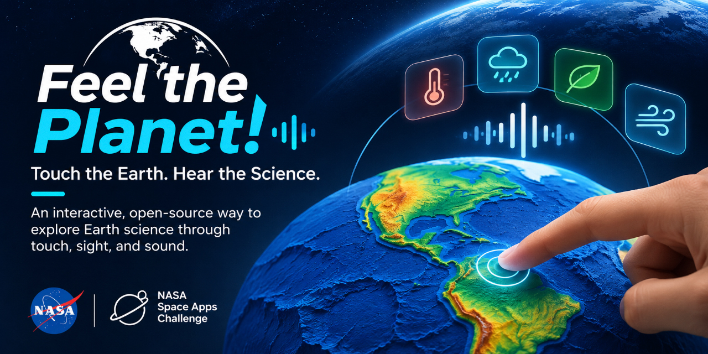
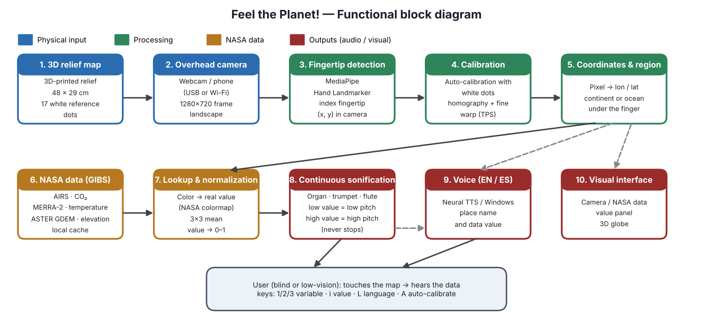
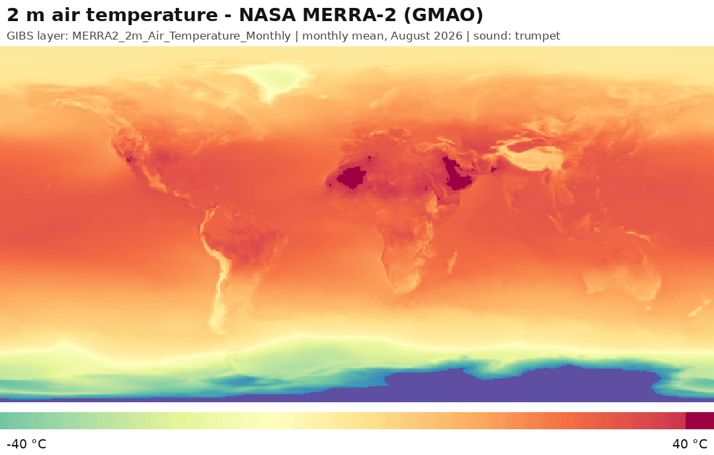
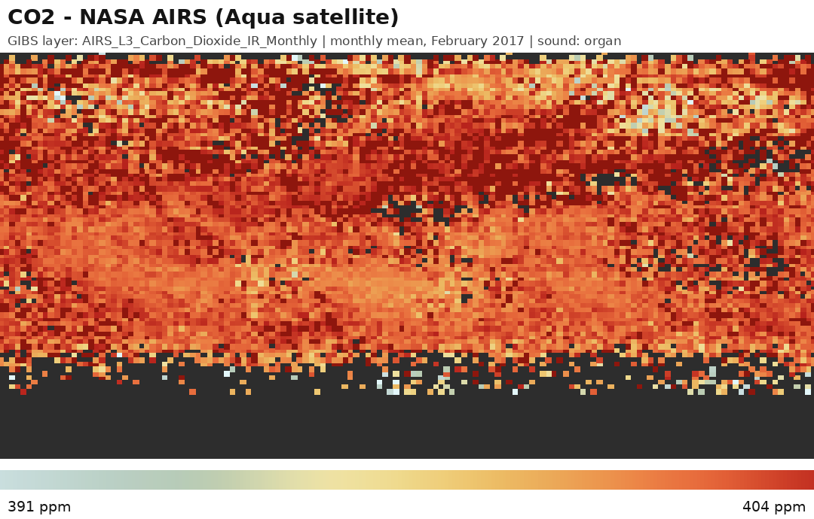

# Feel the Planet! 🌍🔊

**Touch the Earth. Hear the Science.**
*An interactive Earth data sonification experience for everyone, designed first for blind and low-vision people.*

**NASA International Space Apps Challenge 2026 · Durango, Mexico**
**Challenge:** [The Earth Information Jukebox](https://www.spaceappschallenge.org/2026/challenges/)


---

## What it does

You **touch a 3D-printed relief map of the Earth**. A camera above the map tracks your index finger, and the computer **turns real NASA data at that spot into sound**:

- 🎺 **A continuous instrument** plays the value under your finger. Low values sound low-pitched, high values sound high-pitched, and the pitch glides smoothly as you move.
- 🗣️ **A voice** tells you where you are (for example, *"North America"* or *"Gulf of Mexico"*) without interrupting the music.
- 🖥️ **A screen** shows the place, the variable, the measured value, the NASA color legend and the data source.

| Key | Variable | NASA source | Instrument | Low pitch → high pitch |
|---|---|---|---|---|
| `1` | CO₂ (mid-troposphere) | AIRS, Aqua satellite | Organ | less CO₂ → more CO₂ |
| `2` | Air temperature at 2 m | MERRA-2 (GMAO) | Trumpet | cold → hot |
| `3` | Terrain elevation | ASTER GDEM, Terra satellite | Flute | sea level → mountains |

The elevation variable matches the **3D relief you feel with your hand**: touch and hear the mountains at the same time.



---

## Why

NASA's Earth Information Center publishes powerful visualizations of our changing planet, but they are made to be **seen**. Feel the Planet! translates them into **touch and sound**, so that people who cannot see a map can still explore it, compare places and feel the patterns in the data.

---

## Features

- **Real NASA data.** Global layers from [NASA GIBS](https://nasa-gibs.github.io/gibs-api-docs/) (the imagery behind [NASA Worldview](https://worldview.earthdata.nasa.gov/)). Each color is converted back into its physical value with NASA's official colormaps.
- **Continuous sonification.** The sound never stops while you explore. It changes pitch smoothly with the data and gets quieter, but does not stop, while the voice speaks.
- **Accessible by design.** It gives spoken place names and values, has a distinct timbre for each variable, and plays a low-to-high "sweep" so you learn the pitch direction when you change variables.
- **Bilingual.** English by default, Spanish with the `L` key, for both the voice and the interface.
- **Auto-calibration.** Paint 17 white dots on the physical map, press `A`, and the software finds the map corners and fine-aligns itself.
- **Works offline after the first run.** NASA layers and voice clips are cached locally.

---

## Repository layout

```text
NASA_Space_Challenge_2026/
├── README.md                  # This file
├── LICENSE                    # MIT (source code)
├── CREDITS.md                 # Data, libraries and third-party assets
├── requirements.txt           # Python dependencies
├── app/
│   ├── feel_the_planet.py     # Main application
│   ├── mapa.jpg               # Reference world map (region polygons and calibration)
│   └── README.md              # How to run the app
├── docs/
│   ├── architecture.md        # How the system works, step by step
│   ├── sonification.md        # Data-to-sound rules and design decisions
│   ├── nasa-data.md           # NASA layers, units, conversion and limitations
│   ├── calibration.md         # White-dot auto-calibration and manual calibration
│   ├── user-guide.md          # Keys and how to use it
│   ├── ai-disclosure.md       # Use of AI in this project
│   └── images/                # Diagrams and NASA layer previews
├── hardware/
│   └── printable-maps/        # STL files of the 3D relief map
├── datasets/                  # How the NASA data is obtained (no data files in Git)
└── demo/                      # Photos and demo video
```

---

## Quick start

**You need:** Windows 10/11 (also works on Linux and macOS without the Windows voice), Python 3.10+, a webcam or a phone used as a camera, and speakers.

```bash
git clone https://github.com/feel-the-planet/NASA_Space_Challenge_2026.git
cd NASA_Space_Challenge_2026
pip install -r requirements.txt
cd app
python feel_the_planet.py
```

On the first run (internet required), the app downloads automatically:
- the MediaPipe hand model (`hand_landmarker.task`)
- the NASA GIBS layers and their colormaps (to `app/datos_nasa/`)
- the neural voice clips (to `app/voz/`)

After that it works offline.

**Camera:** set `CAMARA` at the top of `feel_the_planet.py`: `0` = laptop camera, `1` or `2` = USB webcam or phone (DroidCam), or a URL such as `"http://192.168.1.50:8080/video"` (IP Webcam app).

Then calibrate once (see [docs/calibration.md](docs/calibration.md)) and touch the map.

| Key | Action |
|---|---|
| `1` `2` `3` | CO₂ / Temperature / Elevation |
| `i` | Say the place and the value |
| `s` | Mute / unmute |
| `v` | View: camera / NASA data / blend |
| `L` | English ⇄ Spanish |
| `A` | Auto-calibrate with the white dots |
| `c` | Manual calibration |
| `t` | Rotate camera 90° |
| `q` / `Esc` | Quit |

---

## NASA data used

| Variable | GIBS layer | Date | Units | Resolution used |
|---|---|---|---|---|
| CO₂ | `AIRS_L3_Carbon_Dioxide_IR_Monthly` | 2017-02 (monthly mean) | ppm | 0.5° |
| Temperature | `MERRA2_2m_Air_Temperature_Monthly` | 2026-08 (monthly mean) | K → °C | 0.5° |
| Elevation | `ASTER_GDEM_Color_Index` | static | m | 0.5° |

<p align="center">
  
  
</p>

Details, conversion method and limitations: **[docs/nasa-data.md](docs/nasa-data.md)**.

> **Scientific note:** values are reconstructed from GIBS imagery and its official colormaps. They are approximations meant for education and exploration, not for scientific or safety-critical decisions.

---

## Hardware

- 3D-printed relief map of the Earth, 48 × 29 cm, printed in 4 tiles: [hardware/printable-maps](hardware/printable-maps)
- An overhead camera on a fixed mount (webcam, or a phone over USB/Wi-Fi)
- A computer with speakers or headphones

---

## Team

**Feel the Planet!** — NASA Space Apps Challenge 2026, Durango.

| Name | Role |
|---|---|
| _Team member_ | _Role_ |
| _Team member_ | _Role_ |

---

## Use of AI

AI tools were used during development. See **[docs/ai-disclosure.md](docs/ai-disclosure.md)** for details.

---

## License and credits

Source code: **MIT License** ([LICENSE](LICENSE)). NASA data, libraries and third-party assets keep their own terms: see **[CREDITS.md](CREDITS.md)**.

This is an independent team project and **not an official NASA product**. NASA does not endorse this project. No NASA logos or insignia are used.

**Feel the Planet! — Touch the Earth. Hear the Science.**
