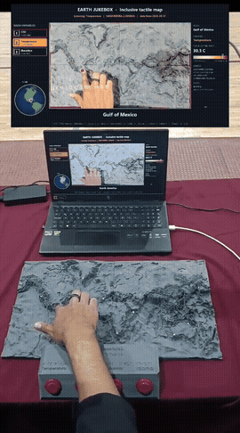
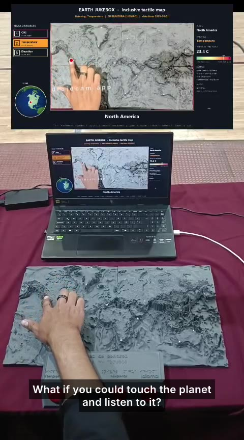
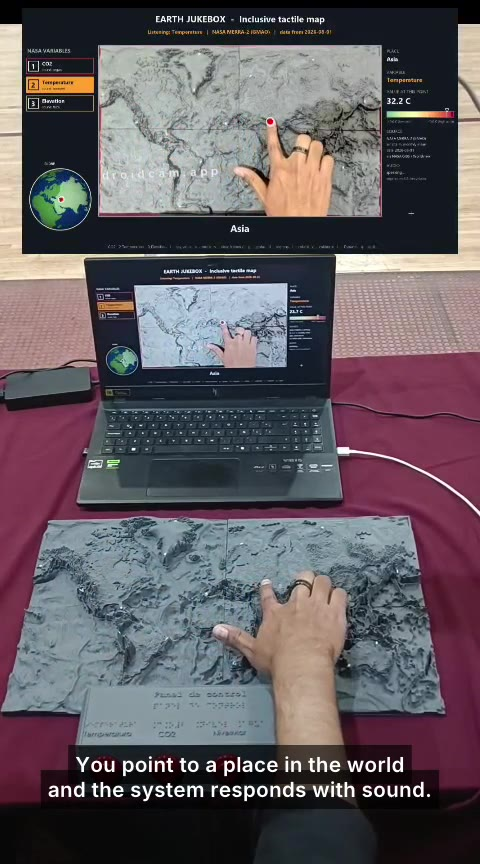
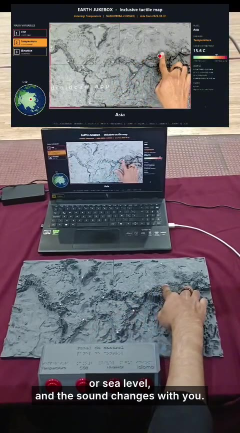
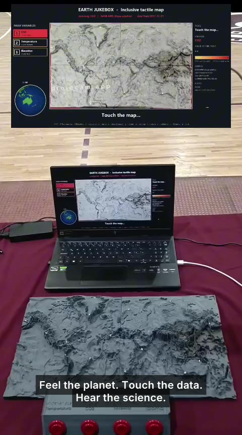

# Demo

**30-second demo video (with English subtitles):** [feel_the_planet_demo.mp4](feel_the_planet_demo.mp4)

| | |
|---|---|
|  |  |
|  |  |

The user touches the 3D relief map. The camera tracks the index finger, the voice says the place, and the instrument plays the NASA value under the finger. The variable and the language are changed with the button panel.
