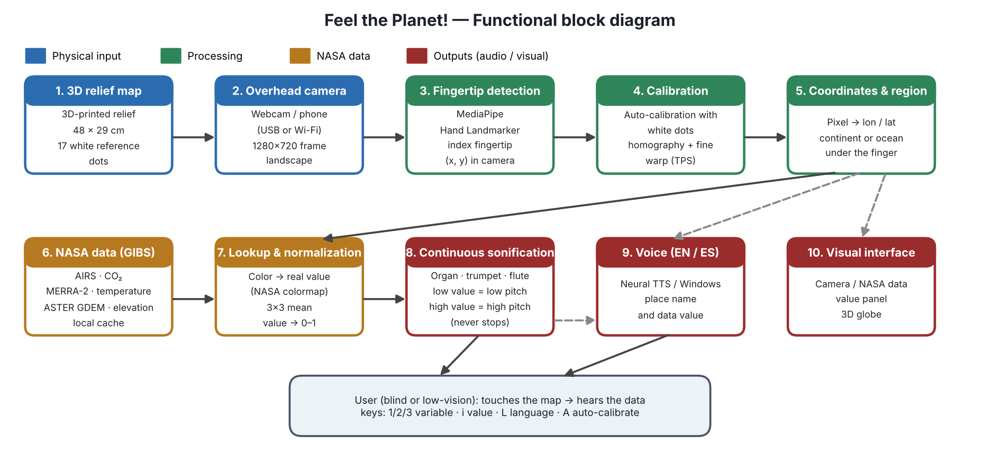

# Architecture

Everything runs in a single Python process (`app/feel_the_planet.py`). Each camera frame goes through this pipeline:

| # | Stage | What happens | Main code |
|---|---|---|---|
| 1 | **Capture** | The camera is opened with MSMF / DirectShow (or as an IP stream). A background thread always delivers the newest frame, so there is no lag. The image is rotated to landscape and fitted to 1280 × 720. | `class Camara`, `acomodar_horizontal()` |
| 2 | **Fingertip detection** | MediaPipe Hand Landmarker finds the index fingertip (landmark 8). | `class DetectorIndice` |
| 3 | **Calibration** | A homography maps camera pixels onto the flat ("straightened") map using its 4 corners. A thin-plate-spline warp built from up to 17 reference points corrects the remaining distortion caused by the 3D relief and the lens. | `class Calibracion`, `crear_ajuste()`, `autocalibrar()` |
| 4 | **Geolocation** | The map pixel is converted to longitude / latitude (polynomial fit over 12 known points) and to a region (continent or ocean polygons). | `ref_a_lonlat()`, `construir_etiquetas()` |
| 5 | **NASA lookup** | The value of the selected variable is read at that lon/lat from the decoded NASA grid (3 × 3 mean, missing values ignored). | `class DatosNASA` |
| 6 | **Normalization** | The value is scaled to 0–1 within the variable's range. | `DatosNASA.normalizar()` |
| 7 | **Sonification** | A continuous instrument changes pitch with the normalized value. | `class Sonificador` |
| 8 | **Voice** | When the finger rests on a new region, its name is spoken over the music. | `class Voz` |
| 9 | **Interface** | Full-screen view: camera / NASA data / blend, value panel, color legend, source and a rotating 3D globe. | `dibujar_margenes()`, `class Globo` |

## Threads

- **Camera reader**: keeps only the latest frame.
- **NASA loader**: downloads and decodes the layers in the background while the app is already running.
- **Voice worker**: generates and plays voice clips in a queue.
- **Sound pre-generation**: builds the instrument loops so pitch changes are instant.

## Design choices

- **One file, few dependencies**, so it is easy to install at a school or museum.
- **Offline after the first run**: NASA layers, colormaps and voice clips are cached on disk.
- **Sound has priority**: the instrument never stops, and the voice is mixed on top of it.
