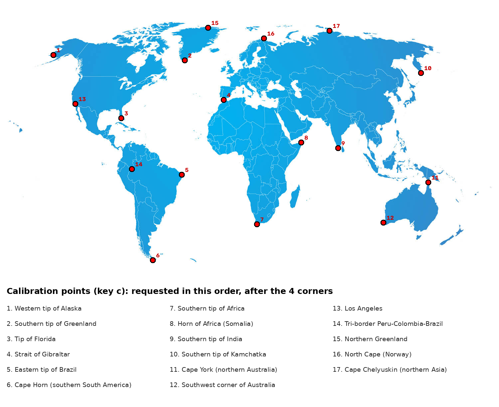

# Calibration

The software needs to know where the physical map is in the camera image. Calibrate once, and again if you move the camera or the map. The calibration is saved in `app/calibracion_mapa.json` and loaded automatically on the next run.

## Step 1 — Corners (key `c`)

1. Fix the camera above the map so that the whole map is visible.
2. Press **`c`** and click the **4 corners** of the map in this order: top-left, top-right, bottom-right, bottom-left (top = North Pole).
3. Drag any corner to adjust it. You can also select a corner with `1`–`4` and move it 1 px with `i`/`j`/`k`/`l`.

## Step 2 — Reference points (key `p`)

1. Press **`p`**. The app asks for the **17 reference points one by one**. The reference map in the right margin, outside the camera image, shows the requested point in red with its name.
2. Click that place on the printed map, or touch it with your index finger and press `Space`. Marked points turn green.
3. Use `n`/`b` for the next/previous point, `x` to delete the current one and `z` to delete all. At least 4 points are needed; marking all 17 gives the best precision.
4. Press **`Enter`** to save and return to the map.

| Key | Action during calibration |
|---|---|
| `r` | Restart the corners |
| `1`–`4`, `i`/`j`/`k`/`l` | Select a corner and move it 1 px |
| `p` | Switch between corners and reference points |
| `n` / `b` | Next / previous point |
| `x` / `z` | Delete the current point / all points |
| `m` | Show or hide the reference map overlay on the camera (hidden by default) |
| `Enter` | Save and use |
| `q` / `Esc` | Quit |

## How it works

- The 4 corners define a **homography** that straightens the camera image into a flat map.
- The reference points feed a **thin-plate-spline warp** that corrects the remaining distortion caused by the 3D relief, the lens and the printing, so that each touch is mapped precisely onto the reference map.

## The 17 reference points

| # | Reference point | # | Reference point |
|---|---|---|---|
| 1 | Western tip of Alaska | 10 | Southern tip of Kamchatka |
| 2 | Southern tip of Greenland | 11 | Cape York (northern Australia) |
| 3 | Tip of Florida | 12 | Southwest corner of Australia |
| 4 | Strait of Gibraltar | 13 | Los Angeles |
| 5 | Eastern tip of Brazil | 14 | Tri-border Peru-Colombia-Brazil |
| 6 | Cape Horn | 15 | Northern Greenland |
| 7 | Southern tip of Africa | 16 | North Cape (Norway) |
| 8 | Horn of Africa (Somalia) | 17 | Cape Chelyuskin (northern Asia) |
| 9 | Southern tip of India | | |
