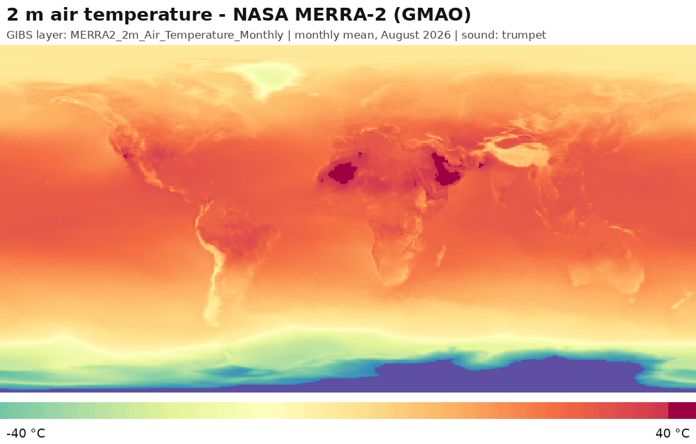
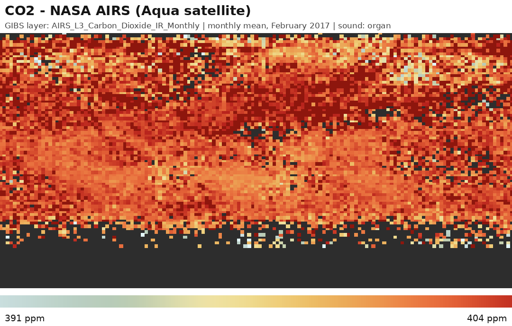

# NASA data

## Source

All layers come from **NASA GIBS** (Global Imagery Browse Services), the service behind **NASA Worldview**:

- WMS endpoint: `https://gibs.earthdata.nasa.gov/wms/epsg4326/best/wms.cgi`
- Colormaps: `https://gibs.earthdata.nasa.gov/colormaps/v1.3/<colormap>.xml`
- Documentation: https://nasa-gibs.github.io/gibs-api-docs/

| Variable | GIBS layer | Colormap | Date | Units | Conversion |
|---|---|---|---|---|---|
| CO₂ (mid-troposphere) | `AIRS_L3_Carbon_Dioxide_IR_Monthly` | `AIRS_Carbon_Dioxide_IR_Monthly` | 2017-02-01 | ppm | none (light smoothing, σ = 2.5 px) |
| Air temperature at 2 m | `MERRA2_2m_Air_Temperature_Monthly` | same name | 2026-08-01 | K | °C = K − 273.15 |
| Terrain elevation | `ASTER_GDEM_Color_Index` | same name | static | m | none (light smoothing, σ = 1.2 px) |

Each layer is requested as a global PNG in EPSG:4326 (geographic lat/lon), 720 × 360 px (0.5° per pixel):

```text
...wms.cgi?SERVICE=WMS&REQUEST=GetMap&VERSION=1.3.0&LAYERS=<layer>&STYLES=&CRS=EPSG:4326
   &BBOX=-90,-180,90,180&WIDTH=720&HEIGHT=360&FORMAT=image/png&TRANSPARENT=TRUE&TIME=<date>
```

## From color back to value

1. Download the layer image and its official **colormap XML** (color → value interval).
2. For each distinct color in the image, find the nearest colormap entry (max. distance 30 RGB units). Its value is the center of the entry's interval.
3. Transparent pixels and colors that are not in the colormap become **no data**.
4. Apply the unit conversion and optional smoothing that ignores missing values.
5. At the touched point, average a 3 × 3 window (1.5° × 1.5°), ignoring missing values.




## Limitations (please read)

- Values are **reconstructed from visualization imagery**, not read from the original science files (NetCDF/HDF/GeoTIFF). They are quantized to the colormap intervals and limited to 0.5° resolution.
- **AIRS CO₂** is a mid-tropospheric product, not a ground-level measurement, and has gaps (grey areas) where no retrieval was possible.
- **MERRA-2** is a model **reanalysis**: an estimate that combines observations and a model, not a measurement at the exact point touched.
- **ASTER GDEM** at 0.5° averages the terrain: individual peaks are smoothed, and there is no data over the oceans.
- The finger → coordinate conversion has an error of about 1–2°, depending on calibration.

This project is for **education and exploration**. For quantitative use, consult the original NASA products.

## Caching

Downloaded files are stored in `app/datos_nasa/` and reused offline. Delete a file to download it again, or change `fecha` in `VARIABLES` to explore another month.
