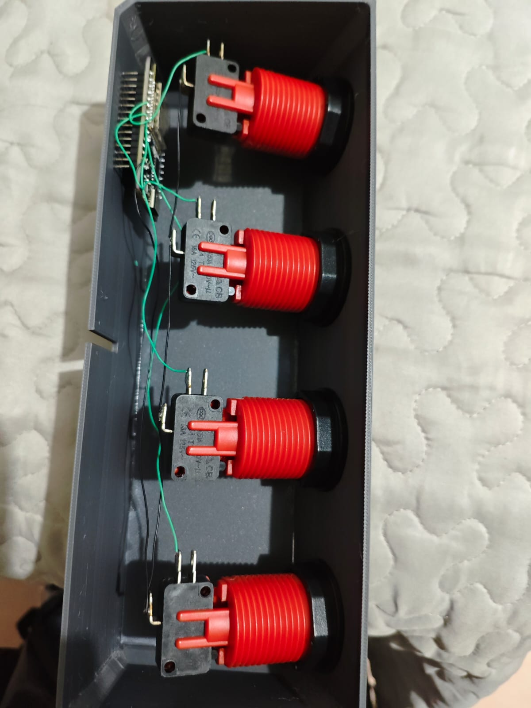

# Firmware — button panel (ESP32 as a Bluetooth keyboard)

A classic **ESP32 DevKit (ESP-WROOM-32)** inside the button box acts as a **Bluetooth keyboard**. Each arcade button sends the same key that the app already understands, so `feel_the_planet.py` needs no changes.

> The classic ESP32 cannot act as a USB keyboard (its USB port is only a serial converter). That is why it uses Bluetooth Low Energy.

## Wiring

Each button's microswitch goes between its GPIO and **GND** (common ground). The firmware uses the internal pull-up resistors, so no external resistors are needed.

| Button | ESP32 pin | Key sent | Function in the app |
|---|---|---|---|
| Temperature | GPIO 32 | `2` | Temperature (trumpet) |
| CO₂ | GPIO 25 | `1` | CO₂ (organ) |
| Elevation | GPIO 26 | `3` | Elevation (flute) |
| Language | GPIO 27 | `l` | Language EN / ES |

Power: USB cable from the computer, or a 5 V phone charger / power bank.

## Library

- **[ESP32 BLE Keyboard](https://github.com/T-vK/ESP32-BLE-Keyboard)** by T-vK (v0.3.0). Install it in the Arduino IDE from **Sketch → Include Library → Add .ZIP Library** with the ZIP from its GitHub releases.
- Board package: **esp32** by Espressif (Arduino Boards Manager). If the library does not compile with core 3.x, use core **2.0.17**.

## Install

1. Open `feel_the_planet_buttons/feel_the_planet_buttons.ino` in the Arduino IDE.
2. Board: **ESP32 Dev Module**. Upload it. If it does not start uploading, hold **BOOT** while it says "Connecting…".
3. On Windows: **Settings → Bluetooth & devices → Add device → Bluetooth → "Feel the Planet"**.
4. Open the app. Each button now changes the variable or the language.

## Notes

- Like any keyboard, keys go to the **active window**. Keep the Feel the Planet window in front.
- The serial monitor (115200 baud) prints every press and the connection state, which is useful for testing the wiring.
- To change a pin or a key, edit the `botones[]` table at the top of the sketch.
