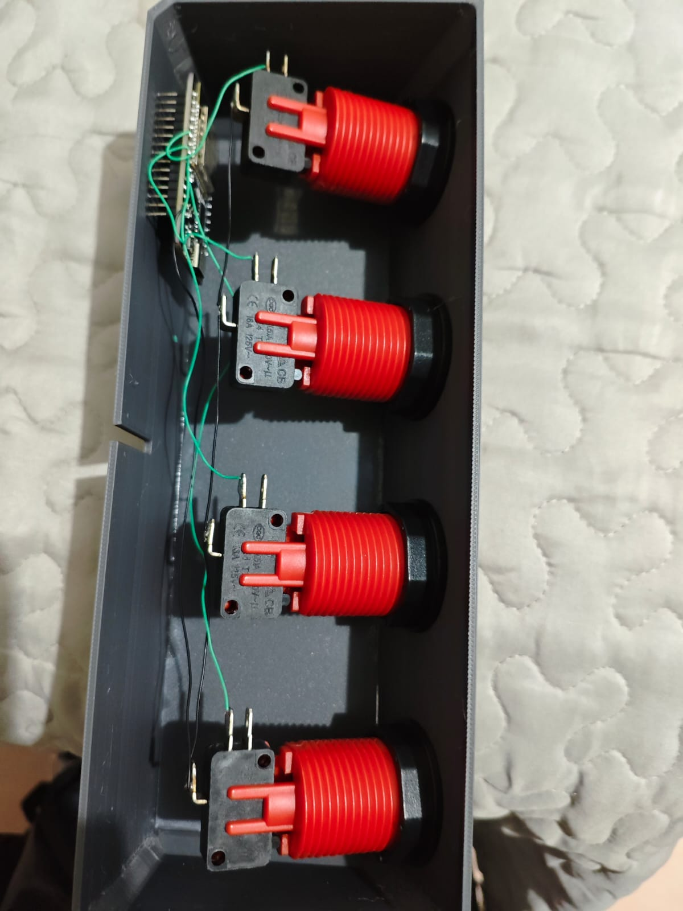

# Button panel

A 3D-printed box with **4 arcade push buttons** (the typical arcade buttons with a microswitch) and an **ESP32** that works as a Bluetooth keyboard. It lets a blind or low-vision user change the variable and the language without looking for keys on a laptop.

| Button | ESP32 pin | Key sent | Function |
|---|---|---|---|
| Temperature | GPIO 32 | `2` | Temperature (trumpet) |
| CO₂ | GPIO 25 | `1` | CO₂ (organ) |
| Elevation | GPIO 26 | `3` | Elevation (flute) |
| Language | GPIO 27 | `l` | English / Spanish |

## Parts

| Qty | Part |
|---|---|
| 1 | ESP32 DevKit (ESP-WROOM-32, USB-C) |
| 4 | Arcade push buttons with microswitch |
| — | Thin wire for the connections (each button to its GPIO, and a common GND) |
| 1 | 3D-printed box + lid (files below) |
| 1 | USB cable (power) |

## CAD files (SolidWorks)

| File | Part |
|---|---|
| `cad/caja_botones.SLDPRT` | Box body with the 4 button holes |
| `cad/tapa_de_la_caja.SLDPRT` | Lid |

_To print them, export each part to STL from SolidWorks (File → Save As → STL)._

Wiring, firmware and the Arduino library: see **[../../firmware](../../firmware)**.
