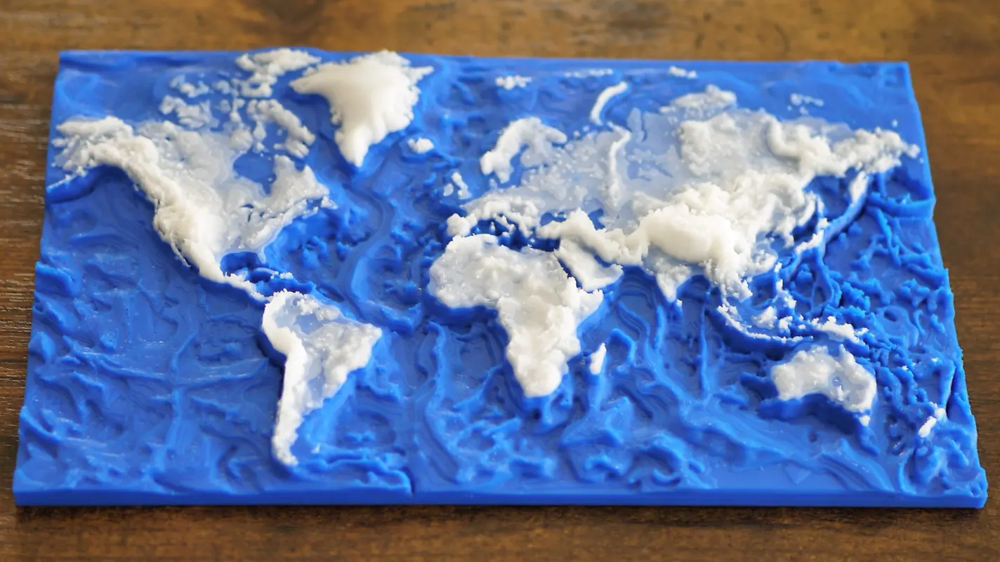

# Earth Topography — 3D Printable Map

## Description

This 3D model represents Earth's landforms and topographic relief. It serves as the physical interactive surface of the **Feel the Planet!** project.

The map is designed to be explored using computer vision. A camera positioned above the model detects the user's index finger, allowing the application to identify geographic locations and generate sounds associated with environmental data.

## Model Preview

## Files

The `stl/` folder contains the 3D-printable model files. Download the required files and open them in a compatible slicer.

## Printing Information

| Parameter | Value |
|---|---|
| File format | STL |
| Printing technology | FDM / FFF |
| Recommended material | PLA |

## Important Notes

For camera-based geographic interaction, the physical map must be aligned with the software's geographic coordinate system.

The camera should remain fixed above the map, and the system must be calibrated before use.

## Credits and License

Model source, geographic elevation data, original author, and applicable license information will be documented here.

**Feel the Planet! — Touch the Earth. Hear the Science.**
